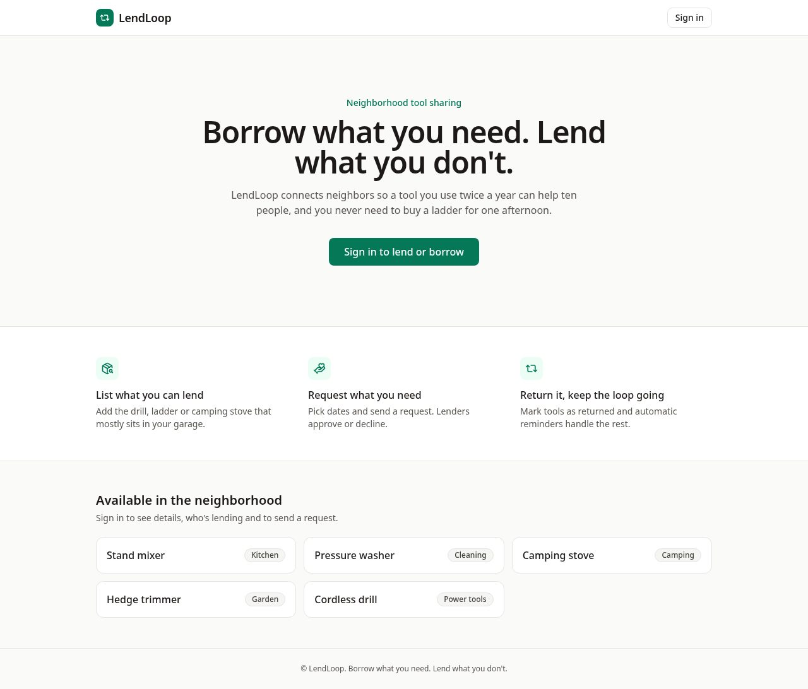
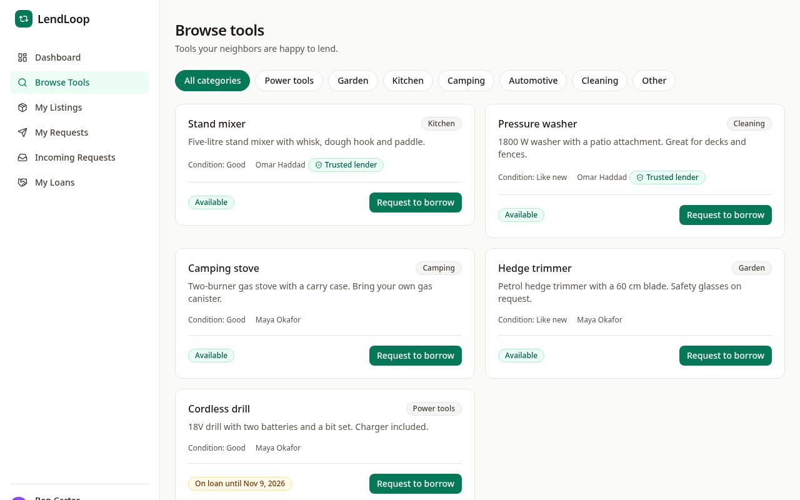
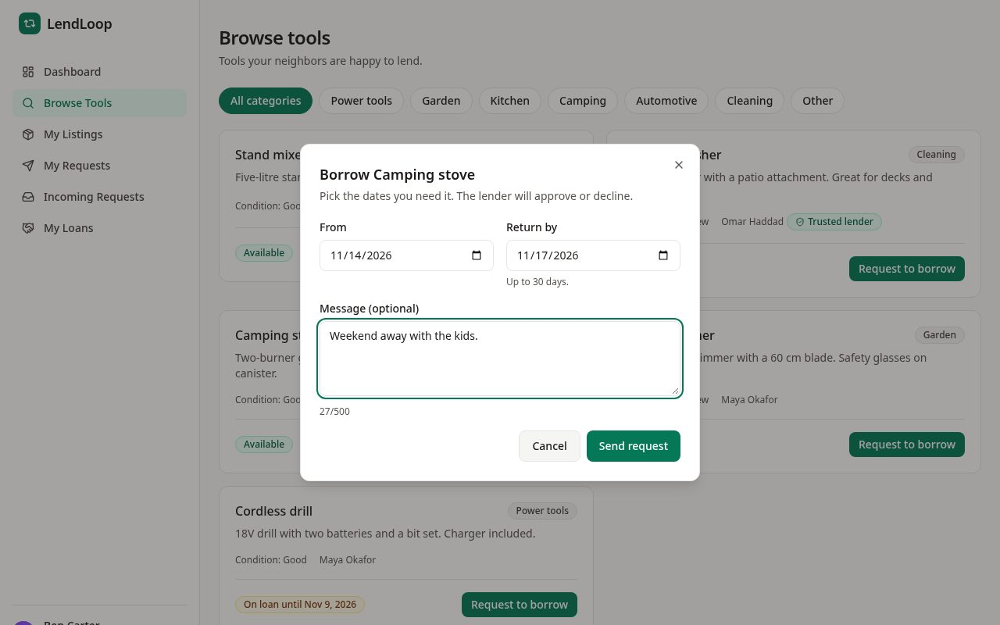
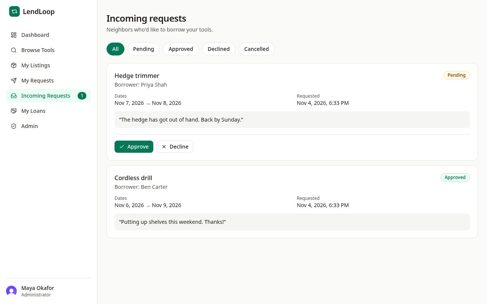
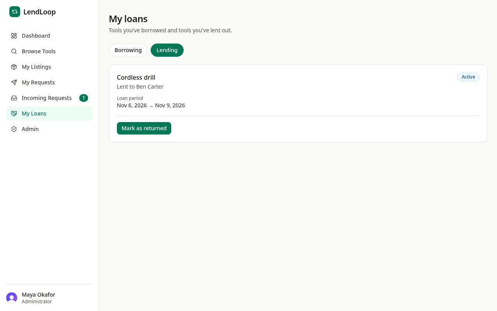
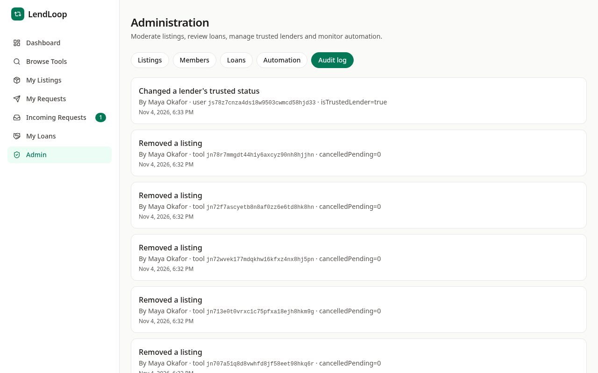
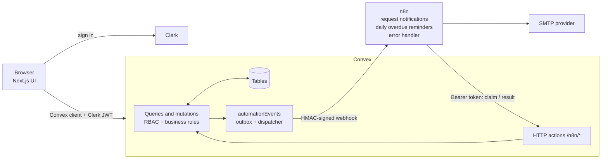

# LendLoop

Neighborhood tool lending. Members list tools, browse what neighbors offer, request a tool for a date range, approve or decline requests, and mark tools as returned. n8n sends the notification emails and a daily overdue reminder.

**Live demo:** https://lendloop-coral.vercel.app (n8n runs at https://n8n.abdullatifnizamani.com).
Sign-up uses a Clerk *development* instance, so you will see a "Development mode" banner. To try it without waiting for an email, register with any address containing `+clerk_test` (for example `you+clerk_test@example.com`); the verification code is always `424242`. Use two browsers (or profiles) to be both lender and borrower.

More detail: [architecture](docs/architecture.md) · [n8n integration](docs/integration.md) · [design decisions](docs/decisions.md) · [security & threat model](docs/security.md) · [authorization matrix](docs/authorization.md) · [data map](docs/data-map.md) · [testing](docs/testing.md) · [runbook](docs/runbook.md)

**Stack:** Next.js (App Router) · React · TypeScript (strict) · Tailwind + shadcn-style UI · Clerk (auth) · Convex (backend/DB) · n8n (automation) · Zod (validation)

## Screenshots

| | |
| --- | --- |
| **Public page:** tagline, sign-in call to action, and a name + category-only tool list<br> | **Browse tools:** category filters, lender name, trusted-lender badge, "on loan until"<br> |
| **Request dialog:** date range (max 30 days) and a note<br> | **Incoming requests:** the lender approves or declines<br> |
| **My loans:** the lender marks a loan returned<br> | **Admin audit log:** who did what, including CLI role changes<br> |

More: [my listings](docs/screenshots/06-my-listings.jpg) · [admin listings](docs/screenshots/07-admin-listings.jpg) · [mobile menu](docs/screenshots/09-mobile-menu.jpg)

## Architecture



- **All business logic and authorization live in Convex.** Next.js has no API routes; its `proxy.ts` only redirects signed-out visitors. Every Convex function re-authenticates the caller from the verified Clerk JWT, then checks role and ownership.
- **Data model** ([convex/schema.ts](convex/schema.ts)): `users` (with `role`), `tools`, `borrowRequests`, `loans`, `automationEvents`, `rateLimits`. Every index serves a specific query.
- **Rules:** request lifecycle `pending → approved | declined | cancelled`; loan lifecycle `active → returned | overdue`. Date ranges are half-open, max 30 days, and an approval re-checks overlap with open loans of the same tool inside one Convex transaction, so two concurrent approvals cannot double-book. Only the lender confirms a return.

### n8n workflows

Exported JSON is in [n8n/workflows](n8n/workflows) (generated from the readable Code-node sources in [n8n/code](n8n/code) with `npm run n8n:build`).

| Workflow | Trigger | What it does |
| --- | --- | --- |
| `request-notification.json` | Webhook | Verify HMAC signature → accept (202) → ask Convex "may I send?" (claim) → build and send email (3 retries) → report `sent` / `failed` |
| `overdue-reminders.json` | Daily 09:00 | Ask Convex to mark past-due loans overdue and list reminders → per reminder: claim → email → report |
| `error-handler.json` | Error Trigger | Reduces a failure to workflow name, execution id and category and reports it to Convex |

Emails: new request (to lender), approved / declined (to borrower), cancelled (to lender), overdue reminder (to borrower).

### Reliability

- **Transactional outbox.** The business change, the `automationEvents` row and the scheduled dispatch commit in one transaction, so a notification is never lost if n8n is down.
- **Event states:** `pending → processing → sent | failed | skipped`. An HTTP 2xx from n8n only means "accepted"; the event is `sent` only when n8n reports the email result. No report within 5 minutes → `failed` (`ACK_TIMEOUT`).
- **Retries:** Convex retries up to 5 times with exponential backoff (network errors, timeouts, 408/425/429/5xx). n8n retries HTTP and email nodes 3 times and classifies SMTP failures.
- **Idempotency:** deterministic event keys (`request.<type>:<id>`, `overdue-reminder:<loanId>:<date>`), enforced in Convex. Re-running an n8n execution cannot send a second email because `claim` refuses events already sent.
- **Watchdog:** a Convex cron runs every 10 minutes and re-arms events whose scheduled dispatch, retry or timeout never ran, so nothing sits "pending" forever unnoticed.
- **Visibility:** admins see every event, with status, attempts, error code and correlation id, under **Admin → Automation**, and can retry failed ones.

## Local setup

**Prerequisites:** Node.js 20.9+, npm, Docker with Compose, a free [Clerk](https://clerk.com) account and a free [Convex](https://convex.dev) account.

### 1. Install and configure

```bash
npm install
cp .env.example .env.local   # Next.js + Convex CLI values
cp .env.example .env         # Docker Compose values (n8n)
```

### 2. Convex

```bash
npx convex dev    # login, creates a dev deployment, writes NEXT_PUBLIC_CONVEX_URL to .env.local
```

Keep it running. It prints the client URL (`https://<name>.convex.cloud`) and the HTTP actions URL (`https://<name>.convex.site`, used as `CONVEX_SITE_URL` for n8n).

### 3. Clerk

1. Create an application and put the publishable and secret keys in `.env.local`.
2. Clerk dashboard → **Integrations → Convex** → activate. Then **Sessions → Customize session token** and add `name` and `email` claims, so members have an address to notify.
3. Set the issuer in Convex (next step) to your Clerk Frontend API URL.

### 4. Convex environment variables (server-side only)

```bash
npx convex env set CLERK_JWT_ISSUER_DOMAIN "https://<your-instance>.clerk.accounts.dev"
npx convex env set CONVEX_N8N_WEBHOOK_SECRET "$(openssl rand -hex 32)"   # n8n needs the same value
npx convex env set N8N_CONVEX_API_SECRET     "$(openssl rand -hex 32)"   # n8n needs the same value
npx convex env set APP_URL "http://localhost:3000"
npx convex env set N8N_WEBHOOK_URL "http://localhost:5678/webhook/lendloop/request-events"
```

> A Convex cloud dev deployment cannot reach `localhost`. To test email delivery locally, expose n8n with a tunnel (`cloudflared tunnel --url http://localhost:5678` or ngrok) and use the `https://` tunnel URL in `N8N_WEBHOOK_URL` and in `N8N_PUBLIC_URL` in `.env`. Without a tunnel, dispatches fail visibly (`NETWORK_ERROR`) and are retried.

### 5. n8n + Mailpit with Docker Compose

Fill in `.env` (Compose refuses to start without these):

```
N8N_ENCRYPTION_KEY=<openssl rand -hex 32>
CONVEX_SITE_URL=https://<name>.convex.site
CONVEX_N8N_WEBHOOK_SECRET=<same value as in Convex>
N8N_CONVEX_API_SECRET=<same value as in Convex>
```

```bash
npm run n8n:up     # n8n at http://localhost:5678, Mailpit inbox at http://localhost:8025
npm run n8n:down   # stop (data kept in a volume)
```

Open http://localhost:5678, create the owner account, then import the workflows (UI: *Workflows → Import from file*, or CLI):

```bash
docker compose exec n8n n8n import:workflow --input=/workflows/error-handler.json
docker compose exec n8n n8n import:workflow --input=/workflows/request-notification.json
docker compose exec n8n n8n import:workflow --input=/workflows/overdue-reminders.json
```

Create one **SMTP** credential named exactly `LendLoop SMTP` (for Mailpit: host `mailpit`, port `1025`, no auth, SSL off). **Activate** *Request notifications* and *Overdue reminders*. Do **not** activate *Error handler*; it is attached to the other two as their error workflow.

### 6. Run the app

```bash
npm run dev    # http://localhost:3000 (keep `npx convex dev` running)
```

Sign up, then make yourself admin (the person must have signed in once):

```bash
npx convex run users:setRole '{"clerkId":"user_XXXX","role":"admin"}'
```

To try it: sign in as user A and add a tool, sign in as user B (another browser profile) and request it, and A gets an email in Mailpit. Approve or decline as A and B gets the outcome. Check **Admin → Automation** for the event status.

### Tests

```bash
npm run typecheck && npm run lint && npm test      # 247 unit, integration and component tests
npm run e2e:install && npm run e2e                  # 31 browser tests (see below)
```

Vitest with `convex-test` covers authorization, IDOR, business rules, the outbox, retries, the watchdog, the audit log and the HTTP endpoints. A second suite runs the exported n8n Code nodes (signature verification and signing, payload validation, email builders).

The Playwright suite drives a running app: sign-up with an emailed code, listings, requests, approval, double-booking refusal, cancel, return, authorization checks, the public tool list's fields and the CSP headers. It needs a Clerk **development** instance (`CLERK_SECRET_KEY`, `NEXT_PUBLIC_CLERK_PUBLISHABLE_KEY`) and `E2E_BASE_URL` (default `http://localhost:3000`). It removes its listings and Clerk users afterwards, but requests and loans remain in the target Convex deployment, so prefer a dev deployment. The GitHub workflow `E2E (browser)` runs it manually against a URL you give it.

## Environment variables

Annotated template: [.env.example](.env.example).

| Variable | Set in | Purpose |
| --- | --- | --- |
| `NEXT_PUBLIC_CLERK_PUBLISHABLE_KEY` | `.env.local` | Clerk frontend key (browser-safe) |
| `CLERK_SECRET_KEY` | `.env.local` | Clerk backend key (**secret**) |
| `NEXT_PUBLIC_CLERK_SIGN_IN_URL`, `..._SIGN_UP_URL`, `..._FALLBACK_REDIRECT_URL` | `.env.local` | Clerk routing |
| `NEXT_PUBLIC_CONVEX_URL` | `.env.local` | Convex client endpoint (browser-safe) |
| `CONVEX_DEPLOYMENT` | `.env.local` | Written by the Convex CLI |
| `CLERK_JWT_ISSUER_DOMAIN` | Convex env | Issuer Convex trusts for JWTs |
| `N8N_WEBHOOK_URL` | Convex env | Where Convex posts signed events (https, or http for localhost) |
| `CONVEX_N8N_WEBHOOK_SECRET` | Convex env + Docker `.env` | HMAC key, Convex → n8n (≥ 32 chars) |
| `N8N_CONVEX_API_SECRET` | Convex env + Docker `.env` | Bearer secret, n8n → Convex (≥ 32 chars, different from the HMAC key) |
| `N8N_CONVEX_SIGNING_SECRET` | Convex env + Docker `.env` (**optional**) | When set, n8n → Convex calls must also carry an HMAC over route + body (≥ 32 chars, different from the other two) |
| `APP_URL` | Convex env | Links inside notification emails |
| `CONVEX_SITE_URL` | Docker `.env` | Base URL of the Convex HTTP actions |
| `N8N_ENCRYPTION_KEY` | Docker `.env` | Encrypts n8n's stored credentials |
| `GENERIC_TIMEZONE`, `LENDLOOP_FROM_EMAIL`, `N8N_PUBLIC_URL` | Docker `.env` (optional) | Schedule timezone, sender address, n8n public URL |

Server secrets are never `NEXT_PUBLIC_*`, never appear in the exported workflows, and are validated where used (a missing or short secret makes the endpoint fail closed).

## Security and data-minimization decisions

- **Authorization in the backend, not the UI.** Identity comes from the verified Clerk token, never from an argument. Roles live only in `users.role`; no public function changes a role (admins are created with an internal function run from the Convex CLI/dashboard). Admin queries use `requireAdmin`; hidden buttons and route guards are conveniences only.
- **IDOR.** The client sends only document ids, which are looked up and then checked for ownership or participation. Private records (requests, loans) return `NOT_FOUND` to outsiders, so guessing an id reveals nothing, not even that it exists.
- **Public data minimization.** The landing page uses a dedicated query whose `returns` validator is an allow-list of `{name, category}`; Convex rejects any extra field, so a later change cannot leak owners or contact details. Other members see only a display name and a "trusted lender" flag; email and Clerk ids appear only in your own record, the admin member list, and the single payload to n8n for the intended recipient.
- **Convex → n8n webhook is HMAC-signed.** `v1=HMAC-SHA256(secret, "v1:" + timestamp + ":" + deliveryId + ":" + rawBody)`, computed over the **raw body bytes** (the Webhook node has Raw Body enabled). Constant-time comparison, ±300 s timestamp window, strict payload validation, and the delivery id in the body must match the signed header.
- **Replay protection and idempotency.** The 5-minute window bounds a captured request; Convex accepts each signed `deliveryId` once at the `claim` step and grants a short lease per event, so a replayed or duplicated delivery cannot send a second email. Event keys are deterministic.
- **n8n → Convex** uses a separate bearer secret (the HMAC key is rejected there). Checks run in order: configured → bearer (constant-time) → body size cap → signature → rate limit → JSON → strict Zod schema. Nothing is processed before authentication. With the optional `N8N_CONVEX_SIGNING_SECRET`, each call must also carry `v1=HMAC-SHA256(secret, "v1:" + timestamp + ":" + route + ":" + body)` within ±300 s, so a leaked bearer token alone is not enough. The route stands in for the delivery id, so a signature cannot be replayed against another endpoint.
- **Minimal payloads.** One recipient per event; no Convex/Clerk ids, tokens or profiles. The borrower's note goes only to the lender on a new request. `automationEvents` store ids, statuses and coarse error codes, never email addresses, message text or signatures. The error workflow reports only workflow name, execution id and a category, never free-text errors.
- **Input validation and safe errors.** Convex argument validators plus shared Zod schemas (length limits, enums, whole-day dates, control characters rejected). Business errors are `{code, message}` with user-safe text; unexpected errors show a generic message. Email HTML escapes user text and strips newlines from subjects.
- **Secrets** live only in env vars (Convex dashboard, git-ignored `.env` files). Exported workflows contain `$env` references and a credential name, verified by a test.
- **Browser hardening:** a Content-Security-Policy built from the Clerk and Convex hosts (no `'unsafe-eval'` in production; tested in a browser with no violations), `X-Frame-Options: DENY`, `nosniff`, `Referrer-Policy`, `Permissions-Policy`.
- **Audit trail.** Admin listing removals, trusted-lender changes, role changes made from the CLI and notification retries are written to an append-only `auditLogs` table in the same transaction as the action (ids and an action name only), and shown under **Admin → Audit log**.

## What I would change to run this in production

- **n8n hosting:** run it behind HTTPS with only the webhook path public and the editor behind SSO/VPN; use queue mode with Postgres and Redis (or n8n Cloud) for scale. [docker-compose.prod.yml](docker-compose.prod.yml) is a single-container starting point that bakes in the workflows.
- **On AWS (Fluence's stack).** I would keep Convex and Clerk, which are the managed parts of this design, and move the self-hosted pieces to AWS. This is a plan, not something I built or tested:
  - **n8n:** ECS Fargate behind an ALB with HTTPS, queue mode with RDS Postgres and ElastiCache Redis; only the webhook path is public, the editor sits behind SSO or a VPN.
  - **Secrets:** Secrets Manager with rotation, injected into the task, instead of n8n reading them from `$env`; per-environment secrets and two active HMAC keys during rotation.
  - **Email:** Amazon SES instead of a generic SMTP provider.
  - **Frontend:** Amplify Hosting, or CloudFront in front of the Next.js app.
  - **Logging, audit and alerts:** CloudWatch logs and alarms on failed events and `ACK_TIMEOUT` rates, CloudTrail for infrastructure changes, and Datadog or Sentry for frontend and application errors.
  - **Backups:** AWS Backup for the n8n database, with `N8N_ENCRYPTION_KEY` stored separately; scheduled Convex snapshot exports with a tested restore.
  - **Auth alternative:** Cognito could replace Clerk if one AWS account had to own everything; I kept Clerk for speed and its hosted flows.
- **Clerk:** move from the development instance to a production instance on a custom domain (Clerk does not allow `*.vercel.app` in production), which also removes the "Development mode" banner and the bot-check friction for scripted testing.
- **Make the second factor mandatory:** `N8N_CONVEX_SIGNING_SECRET` is optional so existing deployments keep working; in production I would require it, plus per-IP limits or a WAF in front of `/n8n/*`.
- **Monitoring:** page on failed events and `ACK_TIMEOUT` rates (the watchdog recovers lost jobs but does not alert), uptime checks on n8n `/healthz` and the Convex site URL, and log shipping.
- **Data retention:** scheduled cleanup of `automationEvents`, `auditLogs` and `rateLimits`, deletion on account removal, and a privacy notice for the email provider. n8n's failed executions can contain the recipient email and note, so treat its database as personal data.
- **Access control:** least-privilege n8n users and two-person approval to grant admin (role changes are audit-logged now, but any operator with CLI access can still grant admin).
- **Known gaps:** the browser suite is not run on every push (it needs a Clerk dev instance and writes to a deployment); Clerk profile data is refreshed on sign-in only (no webhook sync); a duplicate email is possible if n8n sends and then crashes before reporting (at-least-once delivery with a Convex-side duplicate guard).
