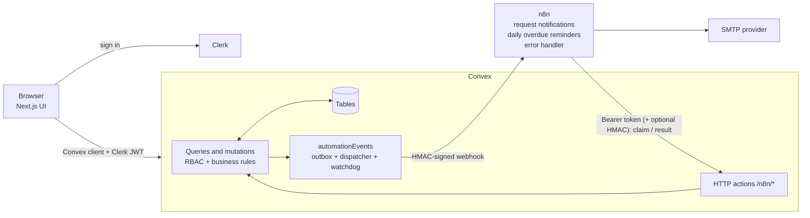

# Architecture

## Overview



- **Next.js** renders the shell and the public page. It has **no business-logic API routes**. `proxy.ts` (Clerk middleware) only redirects signed-out visitors.
- **Clerk** owns sign-in and sessions and issues the JWT (`aud: convex`, plus `name` and `email` claims) that Convex verifies.
- **Convex** holds all data and all rules. Every function re-authenticates the caller from the verified token ([authorization matrix](authorization.md)).
- **n8n** sends the emails. Convex decides *who* gets *what*; n8n only delivers and reports back ([integration](integration.md)).

## Request notification flow (transactional outbox)

```mermaid
sequenceDiagram
  participant U as Borrower (browser)
  participant C as Convex
  participant N as n8n workflow A
  participant M as SMTP provider
  U->>C: requests.create (Clerk JWT)
  C->>C: validate, authorize, insert request<br/>+ insert automationEvent(pending)<br/>+ schedule dispatch (ONE transaction)
  C->>N: POST signed webhook (event -> processing)
  N->>N: verify HMAC over raw body, timestamp, schema
  N-->>C: 202 accepted (not "delivered")
  N->>C: POST /n8n/events/claim {eventId, deliveryId}
  C-->>N: {proceed:true} (lease; replays refused)
  N->>M: send email (3 tries)
  alt sent
    N->>C: POST /n8n/events/result {outcome: sent}
  else failed
    N->>C: POST /n8n/events/result {outcome: failed, errorCode, retryable}
    C->>C: status = failed, schedule retry (backoff, max 5)
  end
```

## Overdue reminder flow

```mermaid
sequenceDiagram
  participant N as n8n workflow B (daily 09:00)
  participant C as Convex
  participant M as SMTP provider
  N->>C: POST /n8n/overdue/run
  C->>C: active & past due -> overdue; create reminder events<br/>key = overdue-reminder:{loanId}:{YYYY-MM-DD}
  C-->>N: minimal reminder list (borrower name/email, tool, due date)
  loop each reminder
    N->>C: claim
    C-->>N: proceed (false if sent / loan returned)
    N->>M: send reminder
    N->>C: result sent | failed
  end
```

## Data model

Defined in [convex/schema.ts](../convex/schema.ts). Every index serves a specific query; no list is built by fetching a table and filtering in memory.

| Table | Important fields | Indexes (purpose) |
| --- | --- | --- |
| `users` | `clerkId`, `name?`, `email?`, `role` (`admin`\|`user`), `isTrustedLender` | `by_clerkId`: resolve the caller from the verified JWT subject on every call |
| `tools` | `ownerId`, `name`, `category`, `condition`, `description`, `status` (`available`\|`unavailable`\|`removed`) | `by_ownerId`: My Listings; `by_status`: public list and unfiltered browse, newest first; `by_status_and_category`: category-filtered browse |
| `borrowRequests` | `toolId`, `borrowerId`, `lenderId`, `startDate`, `endDate`, `message?`, `status` (`pending`\|`approved`\|`declined`\|`cancelled`) | `by_borrowerId_and_status`: My Requests and the pending cap; `by_lenderId_and_status`: Incoming Requests; `by_toolId_and_status`: cascade-cancel when a tool is removed |
| `loans` | `requestId`, `toolId`, `borrowerId`, `lenderId`, dates, `status` (`active`\|`returned`\|`overdue`), `returnedAt?` | `by_requestId`: one loan per request; `by_toolId_and_status`: overlap check on approval (its read range is what serializes concurrent approvals); `by_borrowerId_and_status` / `by_lenderId_and_status`: My Loans; `by_status_and_endDate`: overdue sweep |
| `automationEvents` | `eventKey`, `eventType`, `correlationId`, `status`, `attempts`, `claimedAt`, `claimedDeliveryId`, `errorCode`, `workflowName?`, `executionId?` | `by_eventKey`: idempotency; `by_status`: admin monitoring and the watchdog; `by_recipientUserId`: dashboard activity |
| `auditLogs` | `actorId?`, `action`, `targetType`, `targetId`, `detail?`, `createdAt` | `by_createdAt`: newest first |
| `rateLimits` | `key`, `windowStart`, `count` | `by_key`: fixed-window limiter for the n8n-facing endpoints |

## Business rules

- **Request lifecycle:** `pending → approved | declined | cancelled`. Anything else is rejected with `INVALID_STATE` ([convex/lib/stateMachine.ts](../convex/lib/stateMachine.ts)); no mutation accepts a status from the client.
- **Loan lifecycle:** `active → returned`, `active → overdue`, `overdue → returned`. Only the **lender** confirms a return. Loans are created only by `requests.approve`.
- **Dates** are UTC-midnight timestamps. Start must be today or later and before the end; at most 30 days; at most 365 days ahead. Intervals are half-open, so back-to-back loans (end = next start) are allowed. A loan is overdue once its whole due day has passed.
- **Overlap rule** `existingStart < requestedEnd AND existingEnd > requestedStart` is applied against open (`active`/`overdue`) loans of the same tool, both when a request is created (early feedback) and, authoritatively, on approval. Returned loans free their dates.
- **Concurrency.** Convex mutations are serializable transactions with optimistic concurrency control. Approval reads the tool's open-loan index range; if a concurrent approval inserts an overlapping loan first, one transaction is retried, re-reads, and fails the overlap check. A `by_requestId` check also prevents two loans per request. `convex-test` runs in one process, so its concurrency tests prove the *logic* under interleaved calls, not Convex's production OCC scheduler; that guarantee comes from Convex's documented semantics.
- **Request spam:** at most 20 pending requests per borrower; overlapping duplicate pending requests for the same tool are rejected.
- **Tool removal** is a soft delete. Owners cannot remove a tool that is out on loan; admins can (moderation). Pending requests for a removed tool are cancelled without email, since nobody acted.
- **Availability** is derived from loans, not stored. `tools.status` is only the owner's listing switch, so a tool with a loan next month can still be requested for other dates.
